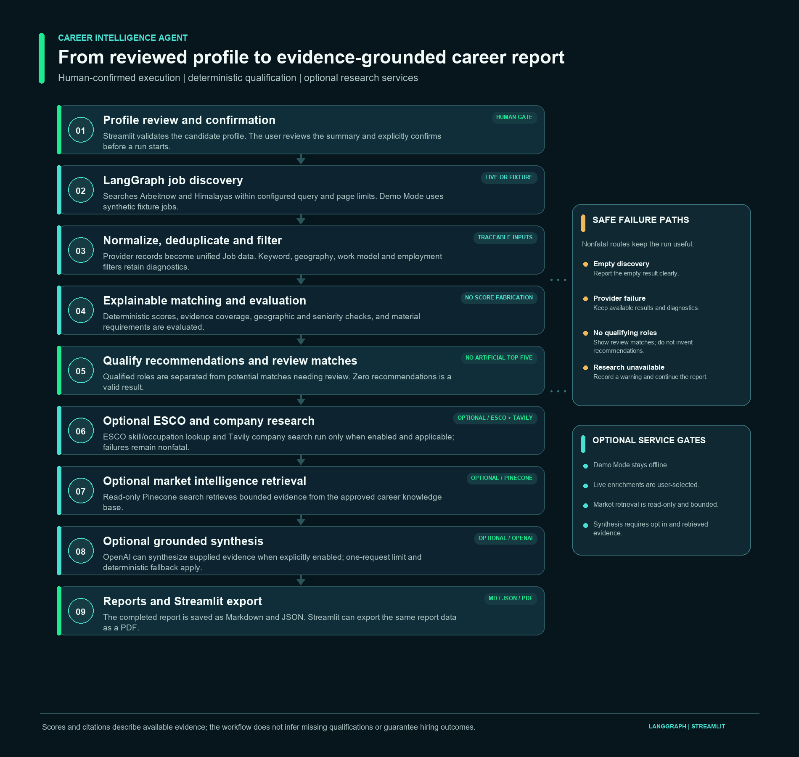

# Career Intelligence Agent

An explainable career research MVP that helps job seekers compare their documented experience with current vacancies, understand which qualifications need verification, and review cited labour-market context. The application combines deterministic matching with bounded external research and produces Markdown and JSON reports.

> **Project status:** MVP implementation is frozen for the Ironhack Project 3 submission. The application and sample candidates are for demonstration; match scores are evidence-alignment indicators, not hiring probabilities or confirmation that an employer's requirements are met.

## Product and intended users

The MVP is intended for job seekers and career changers exploring roles in Germany. Job searches can return many postings without explaining how a person's documented skills relate to the role or which important requirements remain unknown. This agent brings job discovery, profile-based matching, requirement review and source-attributed market context into one reviewable report.

The value proposition is a structured starting point for a career decision: see the evidence behind a match, separate a verified mismatch from missing profile evidence, and follow source links to inspect the underlying vacancy and labour-market material.

## MVP capabilities

- Streamlit interface for building and reviewing a candidate profile before a run.
- Demo Mode using synthetic job fixtures, with no external requests.
- Live job discovery from Arbeitnow and Himalayas, with bounded multi-query search and provider-failure diagnostics.
- Normalized job records, deduplication, country/work-model/employment filtering, explainable scoring, career-direction checks and recommendation qualification.
- A separate review list for promising but insufficiently supported positions; the workflow does not add matches to fill a quota.
- Optional ESCO skill and occupation enrichment, Tavily company research, read-only Pinecone market retrieval, and one-request OpenAI grounded synthesis.
- Markdown and structured JSON reports with source URLs, citation metadata, warnings and diagnostics.

### Current limitations

- The candidate schema and profile entry are not a CV parser or a persistent user account. Profile data is reviewed in the current session; there is no database or authentication.
- Live vacancy coverage and source metadata depend on the two job providers. Listings may be incomplete or unavailable later.
- Geographic eligibility is not the same as work authorization. The MVP assumes the candidate lives in Germany and is authorized to work there; it separately checks evidence that a role can be performed from Germany.
- ESCO lookups, search snippets, semantic similarity and LLM output require human interpretation. A valid citation reference does not prove that a cited source entails every generated claim.
- RAG retrieval uses the existing Pinecone index and a limited set of approved knowledge chunks. The code configuration does not independently verify the live index contents.
- There is no automated application submission, hiring-probability prediction, employer workflow, scheduled monitoring, or email delivery.

## Architecture and workflow

The primary orchestration stack is **LangGraph**. The Streamlit UI collects and validates inputs, asks the user to review the profile, and requires an explicit confirmation before invoking a run. The graph then executes bounded discovery, matching, optional enrichment, report generation and finalization.



The graph's conditional routes handle invalid profiles, empty discovery results, partial provider failures and zero qualifying recommendations. Provider or enrichment failures are recorded as warnings/nonfatal diagnostics when possible; they do not fabricate evidence or prevent a useful report. ESCO and company research are skipped when there are no recommendations. Market retrieval can still run for a profile when enabled; synthesis requires retrieved evidence and an explicit opt-in.

### LangGraph versus n8n

LangGraph is the primary stack for this MVP because its Python `StateGraph` makes the candidate, jobs, evidence, diagnostics and report state explicit between nodes. Conditional edges express the no-jobs, partial-failure and no-recommendation paths directly. Python also keeps Pydantic profile/job validation, deterministic qualification rules, citation checks and mocked tests in the same codebase as the integrations.

This choice offers flexibility for evidence-specific logic and makes it straightforward to test each node and fallback. The trade-off is more integration and operational code: API clients, UI, retries, validation and report output must be maintained in Python. n8n can be a better choice when a team wants a visual workflow editor, quick SaaS connectors, non-developer ownership or operational workflow administration. For this MVP, however, the core value depends on typed state, custom validation and deterministic matching; n8n is not an implemented secondary runtime and no exported n8n workflow is claimed.

## Workflow details

1. **Profile review:** Streamlit validates required titles, skills and experience/project evidence. The user inspects the profile summary and confirms the run. Live Mode has a separate checkbox authorizing the selected external calls.
2. **Discovery:** queries up to three distinct candidate role titles against Arbeitnow and Himalayas. The CLI defaults to one page per provider/query; the supported bounds are 1–5 pages and 1–3 queries.
3. **Normalization and filtering:** provider records are normalized to the shared `Job` model, deduplicated and filtered with missing information kept distinct from a confirmed mismatch. Provider counts and exclusion reasons are retained.
4. **Matching and selection:** deterministic weighted dimensions produce an indicative score and evidence coverage. Separate gates check career direction, seniority, geographic eligibility and material requirements. Strong but provisional items remain review matches rather than recommendations.
5. **Enrichment:** where enabled, ESCO searches official skill/occupation concepts; Tavily searches companies appearing among selected recommendations; Pinecone retrieves up to three source passages for each of at most three market questions. These steps do not change scores.
6. **Synthesis and report:** an optional single OpenAI request can produce structured market and personalized career paragraphs grounded in supplied evidence. Citation IDs are validated and deterministic report content remains available when synthesis is skipped or fails. The final report is written as Markdown and JSON.

## Tools and external services

| Tool/service | Purpose | When it is used |
|---|---|---|
| Arbeitnow Job Board API | Vacancy discovery | Live Mode; no API key configured in this project |
| Himalayas Jobs API | Vacancy discovery and country-filtered results | Live Mode; no API key configured in this project |
| European Commission ESCO API | Skill and occupation concept lookup | Optional enrichment in the UI; public API |
| Tavily Search API | Search result snippets for recommended companies | Optional in the UI; requires `TAVILY_API_KEY` |
| Pinecone Documents API | Read-only semantic search over the career knowledge namespace | Optional in the UI; requires Pinecone and OpenAI credentials |
| OpenAI API | `text-embedding-3-small` query embeddings; optional `gpt-4o-mini` structured synthesis | Only when the corresponding Live Mode option is enabled; synthesis is limited to one request per run |

The Pinecone client configuration targets index `career-market-knowledge`, namespace `career-market-knowledge-v1`, dense field `chunk_vector`, and 1536-dimensional embeddings. The UI leaves optional research and AI features off until selected. Live provider requests and optional external services can incur usage charges under their providers' terms.

## RAG and grounded AI synthesis

The knowledge retrieval step creates a small number of profile- and role-relevant questions, embeds each question with `text-embedding-3-small`, and performs read-only top-three searches in Pinecone. Retrieved entries carry document title, publisher, year, page, source URL, geographic scope and an excerpt. Similarity is used to rank semantic relevance; it is not factual confidence.

When the user separately enables grounded synthesis, the workflow sends bounded complete passages plus candidate/job context to `gpt-4o-mini` (or `CAREER_INTELLIGENCE_MODEL`). The response uses a strict Pydantic structured-output schema and typed reference IDs. Market claims must cite market sources, profile facts must cite candidate evidence, and job requirements must cite the relevant posting. Global evidence is not presented as Germany-specific. Unknown qualifications are not treated as absent. The deterministic report remains the fallback; automated citation validation checks reference identity, not full semantic entailment.

No source documents are uploaded by the normal retrieval workflow. Embedding generation is applied to the search questions, not to the local source PDFs during a run.

## Explainable matching and qualification review

The score combines the existing deterministic dimensions for skills, experience, role interests, seniority/qualifications and additional preferences. The score and evidence coverage summarize the evidence available to those dimensions; neither is a hiring probability nor proof that every employer requirement is met.

Each recommendation includes strengths, gaps, location/seniority evidence, uncertainties and material `requirements_to_verify`. Those requirements distinguish `not_documented`, `partially_documented`, and explicit `does_not_meet_requirement` evidence. An undocumented qualification remains unknown. Roles with unresolved support or hard-requirement concerns appear in **Potential matches requiring review** and are not promoted just to fill the top five.

## Demo Mode and Live Mode

### Demo Mode

Demo Mode uses the local synthetic fixture jobs and does not contact external APIs. No credentials are needed. It is suitable for predictable presentations and offline development. The built-in example profiles are A and B; the two additional synthetic profiles C and D can be entered manually using the [profile C/D entry guide](fixtures/profile_c_d_manual_entry_guide.md).

### Live Mode

Live Mode uses real job provider results. In Streamlit, ESCO, Tavily, Pinecone retrieval and OpenAI synthesis each require their own checkbox; synthesis is disabled until market retrieval is selected. Before execution, the user reviews the profile and checks the authorization box. Search counts are bounded in the sidebar. Provider integrations can be used without keys where the provider is public; Tavily, Pinecone and OpenAI require their corresponding credentials.

The CLI is an explicit user-triggered interface rather than a separate profile-confirmation UI. Its `--offline` flag prevents job-provider calls. In CLI Live Mode, ESCO and Tavily enrichment are enabled by default (when there are recommendations); use `--no-esco` and `--no-company-research` to disable them. Pinecone retrieval and OpenAI synthesis remain opt-in. The UI has separate checkboxes for all optional services. Do not run a live command unless you intend to contact the selected providers.

## Setup and run locally

### Requirements

- Python 3.11 recommended (Python 3.10+ syntax is used).
- Windows PowerShell commands below; the project uses standard Python tooling.
- External credentials only for the Live Mode services you choose. Demo Mode requires none.

### Install

```powershell
py -3.11 -m venv .venv
.\.venv\Scripts\Activate.ps1
python -m pip install --upgrade pip
python -m pip install -r requirements.txt
if (-not (Test-Path .env)) { Copy-Item .env.example .env }
```

Open `.env` locally and replace placeholders only for the services you plan to use. Do not commit `.env`. Do not overwrite an existing `.env` when creating the example copy.

### Start the Streamlit application

```powershell
python -m streamlit run streamlit_app.py
```

In the browser, choose Demo Mode or Live Mode, complete or load a profile, select **Review candidate profile**, inspect it, and confirm before choosing **Run Career Intelligence Agent**. Demo Mode is the default. Profiles C and D are manual-entry demo/live candidates, using the linked guide; there is no profile-import feature.

### Run the Python/LangGraph CLI

Offline example (no network calls):

```powershell
.\.venv\Scripts\python.exe scripts\run_agent.py --profile a --offline --output-dir reports\demo
```

Live job discovery only, disabling optional ESCO and Tavily research; RAG is off unless explicitly enabled:

```powershell
.\.venv\Scripts\python.exe scripts\run_agent.py --profile a --queries 3 --pages 1 --no-esco --no-company-research --no-market-intelligence --output-dir reports\live
```

To enable live Pinecone retrieval and one grounded synthesis request, use `--allow-live-rag --allow-llm-synthesis`. In this CLI Live Mode, ESCO and Tavily are already enabled unless disabled; do not use this command unless external requests and possible charges are intended:

```powershell
.\.venv\Scripts\python.exe scripts\run_agent.py --profile a --queries 3 --pages 1 --allow-live-rag --allow-llm-synthesis --output-dir reports\live-full
```

CLI `--profile` currently accepts `a` or `b`. For custom profiles, use the Streamlit form. Other useful bounds/options are `--queries 1..3`, `--pages 1..5`, `--top-n 1..5`, `--query`, `--no-esco`, `--no-company-research`, and `--no-market-intelligence`. `--allow-live-esco` and `--allow-live-company-research` are used to explicitly enable these services with offline fixture jobs; in live discovery mode they are accepted but not required.

## Configuration variables

The checked-in `.env.example` contains placeholders only. Variables read by the application:

| Variable | Required for | Default / notes |
|---|---|---|
| `OPENAI_API_KEY` | Pinecone query embeddings and optional synthesis | Not needed in Demo Mode or when those services are disabled |
| `PINECONE_API_KEY` | Live Pinecone retrieval | Not needed when retrieval is off |
| `TAVILY_API_KEY` | Live company research | Not needed when Tavily research is off |
| `CAREER_INTELLIGENCE_MODEL` | Optional grounded synthesis model override | Defaults to `gpt-4o-mini` |

The embedding model, Pinecone index, namespace, and vector field are fixed in the current code; `EMBEDDING_MODEL`, `OPENAI_MODEL`, and `PINECONE_INDEX_NAME` are not configuration variables used by this MVP. Arbeitnow, Himalayas and ESCO do not require project API keys. Environment values are loaded from the project `.env` at runtime in Live Mode; keys are never intended to be printed in reports.

## Reports and interpretation

The workflow saves one `.md` and one `.json` report per run under the selected output directory. The Streamlit UI uses `reports/streamlit/`; CLI defaults to `reports/`. Reports include the search scope, jobs evaluated, recommendations, review matches, provider counts, duplicate/filter diagnostics, enrichment status and source references.

Read the score as a compact summary of profile-to-posting evidence alignment. Read `evidence_coverage` as the share of matching signals that could be evaluated, not as qualification coverage. A zero-recommendation report is a valid outcome: review matches and exclusion reasons remain available, and unsupported recommendations are not manufactured.

Sanitized saved Live Mode examples (historical snapshots, not recalculated by the current code):

- [Synthetic Profile C — Markdown](examples/reports/profile_c_live_snapshot.md) and [JSON](examples/reports/profile_c_live_snapshot.json)
- [Synthetic Profile D — Markdown](examples/reports/profile_d_live_snapshot.md) and [JSON](examples/reports/profile_d_live_snapshot.json)

## Testing

Run the offline automated suite:

```powershell
.\.venv\Scripts\python.exe -m pytest -q
.\.venv\Scripts\python.exe -m compileall -q src scripts streamlit_app.py
```

The suite uses mocked API responses and synthetic fixtures; it does not require live API calls. Streamlit UI checks are included in pytest. For an offline workflow smoke test:

```powershell
.\.venv\Scripts\python.exe scripts\run_agent.py --profile a --offline --output-dir reports\demo
```

## Repository map

| Path | Purpose |
|---|---|
| `streamlit_app.py` | Candidate profile, review/confirmation, settings, dashboard and report-download UI |
| `src/career_agent/workflow.py` | LangGraph state, nodes, routing, enrichment and report finalization |
| `src/career_agent/candidate.py` | Pydantic candidate profile schema |
| `src/career_agent/models.py` | Unified normalized job schema |
| `src/career_agent/job_sources/` | Arbeitnow and Himalayas API adapters |
| `src/career_agent/discovery.py`, `integration.py`, `filtering.py` | Search, multi-query integration, deduplication, filters and diagnostics |
| `src/career_agent/matching.py`, `requirements_review.py` | Explainable scoring, recommendation gates and material requirements to verify |
| `src/career_agent/esco.py` | ESCO API client and concept enrichment |
| `src/career_agent/company_research.py` | Tavily company search, source handling and identity checks |
| `src/career_agent/vector_store.py` | OpenAI embeddings and Pinecone Documents API retrieval helpers |
| `src/career_agent/intelligence_synthesis.py` | Bounded OpenAI Structured Outputs synthesis and citation validation |
| `scripts/run_agent.py` | CLI entry point to the LangGraph workflow |
| `fixtures/` | Synthetic candidate and job fixtures; C/D manual-entry guide |
| `tests/` | Offline unit, integration and Streamlit AppTest coverage |
| `examples/reports/` | Sanitized historical Live Mode Markdown/JSON examples |
| `knowledge_base/` | Local extraction, chunking and rights-reviewed source workflow; raw/processed/review content is Git-ignored |
| `reports/`, `outputs/` | Local generated reports and test outputs; Git-ignored |
| `gtm_future_sprints.md` | Post-MVP user acquisition and validation sprint hypotheses |
| `Project3_Final_Deliverables.md` | Authoritative course submission checklist |

See [Future Go-to-Market Sprints](gtm_future_sprints.md) for three post-MVP validation sprints. These are hypotheses and measurable targets, not achieved results.

## Demo recording

**Demo video:** https://drive.google.com/file/d/11xdEmT_8QHtuEUmSNjMpe7evBrxqvtHO/view?usp=drive_link
